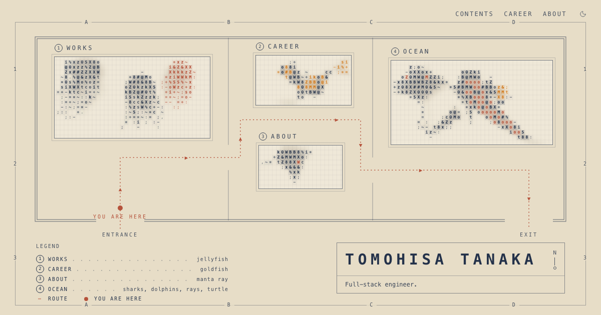

# Tomohisa Tanaka — portfolio

The portfolio of Tomohisa Tanaka (inenico), a full-stack engineer.

**https://portfolio.inenico.dev**



The site is an aquarium. The home page is its floor plan, drawn like a sheet of an architect's
drawings, and each tank is a page. Clicking a tank dives the camera into it, and the page shows
over the water. Every creature is drawn in characters and swims in real time:

| Tank     | Page      | Lives in it                                                  |
| -------- | --------- | ------------------------------------------------------------ |
| 1 WORKS  | `/plates` | jellyfish                                                    |
| 2 CAREER | `/career` | goldfish                                                     |
| 3 ABOUT  | `/about`  | manta rays                                                   |
| 4 OCEAN  | `/ocean`  | whale shark, hammerheads, dolphins, manta rays, a sea turtle |

Most creatures keep away from the pointer and react to clicks; the dolphins come to it. There are
light and dark themes.

## Development

Uses [Bun](https://bun.sh) for packages and Node (version in `.node-version`) to run the tools.

```bash
bun install
bun run dev        # http://localhost:3000
```

| Command                           | What it does                                                  |
| --------------------------------- | ------------------------------------------------------------- |
| `bun run build`                   | Production build                                              |
| `bun run preview`                 | Serves the production build locally, as on Cloudflare Workers |
| `bun run lint`                    | oxlint                                                        |
| `bun run format` / `format:check` | oxfmt: format / check formatting                              |
| `bun run typecheck`               | `tsc --noEmit`                                                |

Built with TanStack Start (React), Tailwind CSS and Vite, and served by Cloudflare Workers.

## Where things are

| Path                                 | What                                                       |
| ------------------------------------ | ---------------------------------------------------------- |
| `src/features/works/works.server.ts` | All the text: name, tagline, about, career and works       |
| `src/features/atlas/`                | The pages, the aquarium map and the layout with its camera |
| `src/features/jellyfish/`            | The water and its creatures, drawn on a canvas             |
| `src/routes/`                        | One file per page                                          |
| `src/lib/seo.ts`                     | Titles, descriptions and link previews for each page       |

### Adding a work

Add an entry to `works` in `works.server.ts`, with its image in `public/images/plates/`. A work
with `draft: true` stays off the site (its page answers not found) until the flag is removed.

## CI/CD

| Workflow             | When                               | What                                     |
| -------------------- | ---------------------------------- | ---------------------------------------- |
| PR check             | Every pull request                 | Lint, format, typecheck and build        |
| Deploy to Cloudflare | Every push to `main`               | Runs PR check, then deploys if it passes |
| Verify actions.lock  | Pull requests and pushes to `main` | Checks the pinned action versions        |

Deploying needs two repository secrets: `CLOUDFLARE_API_TOKEN` (made from the "Edit Cloudflare
Workers" template) and `CLOUDFLARE_ACCOUNT_ID`.

Every action is pinned to a commit in `.github/workflows/actions.lock`. After changing any `uses:`,
run [`gh actions-lock`](https://github.com/github/gh-actions-lock) and commit the lockfile with it.

The site's address is written in `src/lib/seo.ts`, `public/robots.txt` and `public/sitemap.xml`;
change all three if it moves.
